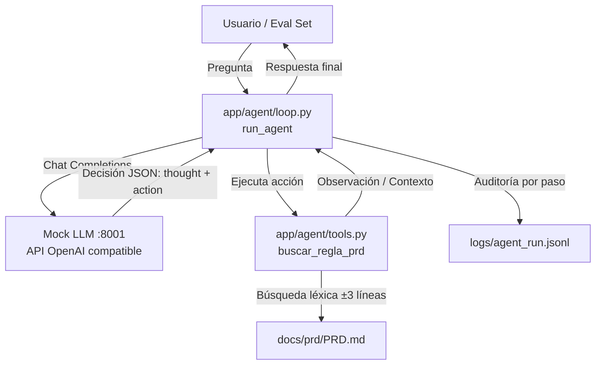

# Proyecto Final · Alan Duarte

Agente RAG que responde preguntas sobre el PRD "Historial de Transacciones LegacyPay". Basado en el patrón ReAct (Reason -> Act -> Observe) con retriever léxico sobre `docs/prd/PRD.md` y arquitectura robusta con barandas de seguridad.

---

## 1. Qué hace

El sistema implementa un **Agente Autónomo ReAct (Reasoning + Acting)** que asiste a desarrolladores, auditores y comercios respondiendo preguntas sobre las especificaciones de negocio del módulo **Historial de Transacciones de LegacyPay** a partir del PRD auditado (`docs/prd/PRD.md`).

El agente opera en un ciclo dinámico: analiza la consulta del usuario, decide de forma autónoma si requiere recuperar evidencia utilizando la herramienta `buscar_regla_prd`, inspecciona las observaciones obtenidas y sintetiza una respuesta final con respaldo verificable (líneas y contexto del documento), rechazando de manera controlada consultas fuera del alcance del dominio.

---

## 2. Cómo probarlo en 5 minutos

### Requisitos previos
- **Python 3.12**
- **uv** (`curl -LsSf https://astral.sh/uv/install.sh | sh`)

### Pasos de ejecución

1. **Clonar y sincronizar dependencias:**
   ```bash
   git clone https://github.com/alanduartee/laboratorio-cird.git
   cd laboratorio-cird
   git checkout proyecto-final
   uv sync --all-groups
   ```

2. **Levantar el servicio Mock LLM (en una terminal independiente):**
   ```bash
   uv run --frozen uvicorn app.mock_llm:mock_app --port 8001
   ```
   *(El servicio simula la API de OpenAI Chat Completions de forma local y determinística).*

3. **Ejecutar una consulta directa al agente:**
   ```bash
   uv run --frozen python -c "
   from openai import OpenAI
   from app.agent.loop import run_agent
   client = OpenAI(base_url='http://localhost:8001/v1', api_key='mock')
   print(run_agent('¿cuál es el rango máximo del historial?', client))"
   ```

4. **Correr la suite de evaluación Golden Set:**
   ```bash
   uv run --frozen python evals/eval_agent.py
   ```

5. **Validar la suite completa de calidad y CI local:**
   ```bash
   uv run --frozen ruff check .
   uv run --frozen mypy app/ --ignore-missing-imports
   uv run --frozen bandit -r app/ -ll -q
   uv run --frozen pytest -q --cov=app --cov-report=term-missing --cov-fail-under=60
   ```

---

## 3. Arquitectura del Agente



- **Tools (`app/agent/tools.py`)**: Exporta el esquema formal `TOOLS_SCHEMA` y la función `buscar_regla_prd(termino: str) -> str` que implementa un retriever léxico con ventana de contexto de ±3 líneas, indicación de número de línea y manejo de casos borde.
- **Loop (`app/agent/loop.py`)**: Orquesta el ciclo ReAct dinámico sin lógica determinística cableada; el modelo de lenguaje decide si continuar buscando o emitir la respuesta final.
- **Auditoría estructurada (`app/agent/logger.py`)**: Registra de manera acumulativa cada acción en `logs/agent_run.jsonl` con marca temporal ISO UTC, número de paso, herramienta, argumentos y resumen del resultado.
- **Contratos y Capas Backend (`app/`)**: Mantiene la API REST LegacyPay con Clean Architecture en 3 capas (Router, Service, Repository) y validación Pydantic v2 desarrollada en el Laboratorio 3.

---

## 4. Barandas de Seguridad Aplicadas

El agente incorpora barreras de contención visibles y documentadas en código:

1. **Baranda #1 · SCOPE (`app/agent/loop.py:16-28`)**:
   - Definida dentro de `SYSTEM_PROMPT`.
   - Restringe el dominio de actuación estrictamente al contenido del PRD.
   - Prohíbe explícitamente la ejecución de acciones destructivas y la invención de información (*alucinación*).
   - Obliga al agente a responder `"fuera de alcance"` o `"Sin coincidencias"` ante consultas ajenas (ej. capitales geográficas o preguntas fuera de alcance).

2. **Baranda #3 · BUDGET (`app/agent/loop.py:12`)**:
   - Variable constante `MAX_STEPS = 5`.
   - Impone un límite estricto de pasos/iteraciones por consulta.
   - Previene loops infinitos, consumo desmedido de cómputo y degradación de latencia.

---

## 5. Criterios de Aceptación Cumplidos

- [x] **Eval Set automatizado:** 3/3 casos pasan exitosamente en `evals/eval_agent.py` (2 positivos + 1 adversarial).
- [x] **Trazabilidad auditable:** Cada ejecución genera un registro estructurado en `logs/agent_run.jsonl`.
- [x] **Contención adversarial:** El agente rechaza responder preguntas fuera de dominio sin generar alucinaciones.
- [x] **CI en verde:** Pipeline de GitHub Actions ejecutando `ruff`, `mypy`, `bandit` y `pytest`.
- [x] **Cobertura de tests:** Cobertura de código superior al 93% en el directorio `app/` (61 tests unitarios).

---

## 6. Limitaciones Conocidas

1. **Retriever léxico simple:**
   - La búsqueda opera por coincidencia textual literal (case-insensitive).
   - No cuenta con embeddings vectoriales ni similitud semántica, por lo que puede requerir términos clave presentes en el documento.
2. **Servidor Mock LLM determinístico:**
   - El entorno de evaluación utiliza el servidor simulado en el puerto 8001 para garantizar reproducibilidad sin costo de API keys.
   - Las respuestas siguen heurísticas de extracción de keywords y no reproducen la totalidad de la variabilidad probabilística de un LLM en producción.
